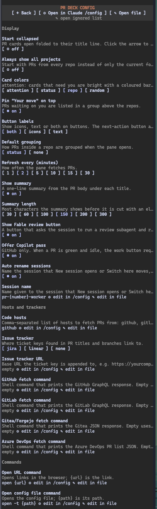

# pr-deck

A Claude Code mod that keeps your open pull requests in a side pane, so you can see what is waiting on you without leaving the session. PRs are grouped by repo, stacked PRs (a PR whose base is another of your branches) draw as a chain, and it reads from GitHub, GitLab, Gitea/Forgejo and Azure DevOps.


Each card shows the number, title and state, a one-line summary from the PR body, and buttons to copy the link, open it in the browser or copy the number. The arrow before the number collapses the card to its title line.


When the pane is scoped to the session's repo you only see that one, here with a stack of three:


Under the CI, review and diff stats you get the ticket key, linking to your tracker, and the branch name, which opens the PR's files tab. Then the action row:

- ***→ Next action***: whatever the PR needs now (fix CI, rebase, address comments, request a review, mark ready or merge). Pressing it sends the matching prompt to the session.
- ***✦ Fable review***: asks the session to run a review subagent and report back to you, without posting anything on the code host.
- ***❯ Work on it***: loads the PR into the current session. On GitHub, once a PR is green and only waiting on people, this becomes ***✦ Copilot pass***, which requests a Copilot review and works through its comments.
- ***◉ watch***: asks the session to keep watching the PR, check its CI and review state every few minutes, tell you about each change in one line, and stop once CI passes and nothing else needs you.
- ***⎇ Switch here***: moves the current session to the PR's repo and branch. If you are not in a clone of that repo, the session finds one (or clones it), checks out the branch, summarizes the PR and waits.
- ***⧉ New session***: opens a new Claude session in the PR's clone folder with the same prompt as ***Work on it***. It opens a tab or window in the terminal you are using (see Commands) and a toast tells you where it went, or what went wrong.

***⇄ move***, in the first button row, overrides the status when the automatic one is wrong, say a PR marked ***● needs you*** that you cannot do anything about. Each press cycles to the next status (***○ waiting***, ***● needs you***, ***✓ approved***, then back to ***auto***). An overridden PR gets a dim ✎ before its status, and everything that depends on the status follows: colour, group, ***● YOUR MOVE*** and the ***NEED YOU*** count. Overrides are saved in the config file.

The pane scopes to the repo the session runs in, with a button to show all repos instead. Repos and stacks collapse, and repos you do not care about can be ignored. ***⊖ collapse*** folds one level per press (cards to their title line, then status groups and stacks, then repos and ***● YOUR MOVE***), and the press after that opens everything again. The button shows the current level out of 3.

### Your move and card colours

With the default `attention` colours, a PR needs you when its next action is something you can do right now: mark ready, fix CI, rebase, address comments, request a review or merge. Those cards get a bright border and a bar on the left (the repo's colour when grouped by status, the status colour otherwise). Cards waiting on CI, a reviewer or another PR are dimmed. The status label in the corner always keeps its own colour.

With `Pin "Your move" on top` on, PRs that need you are also listed in a ***● YOUR MOVE*** group above the repos, grouped by repo with the most urgent one first (and by status too when grouping is on). Click the group title to collapse it. A stack where every PR needs you moves there whole; when only some of them do, the stack stays in its repo and those PRs show up in both places.

## Install

From the prompt of a Claude Code session:

```
/plugin install pr-deck --marketplace khaosdoctor/claude-pr-list-mod
```

Answer `y` to add the marketplace, then pick a scope. From a shell:

```bash
claude plugin install pr-deck --marketplace khaosdoctor/claude-pr-list-mod
```

In the desktop app, click + next to the prompt box, then ***Plugins -> Add marketplace*** with `khaosdoctor/claude-pr-list-mod`, then ***Add plugin***.

### Install from a local clone

```bash
claude plugin marketplace add <path to clone>
claude plugin install pr-deck@claude-pr-list-mod
```

After pulling changes, refresh the marketplace, update the plugin and restart Claude Code:

```bash
claude plugin marketplace update claude-pr-list-mod
claude plugin update pr-deck@claude-pr-list-mod
```

While developing, `claude --plugin-dir <path to clone>` loads the mod for that session only and reloads it when you edit the files.

## Requirements

The CLI of each code host you enable, signed in:

| Host | CLI | Sign in |
| --- | --- | --- |
| GitHub | [`gh`](https://cli.github.com) | `gh auth login` |
| GitLab | [`glab`](https://gitlab.com/gitlab-org/cli) | `glab auth login` |
| Gitea, Forgejo | [`tea`](https://gitea.com/gitea/tea) and `jq` | `tea login add` |
| Azure DevOps | [`az`](https://learn.microsoft.com/cli/azure) with the `azure-devops` extension | `az login`, then `az extension add --name azure-devops` |

The default commands are macOS ones: `open` for links and the config file, `git` for the current repo, and `osascript` for iTerm and Terminal when opening sessions (herdr also needs `jq`). On another system, change them under Options.

Gitea, Forgejo and Azure DevOps do not give the mod CI state or unresolved threads, so those cards show no CI and zero unresolved threads. Azure DevOps also shows no diff stats, and it lists the PRs of the project `az` detects from the git remote or from `az devops configure`.

## Usage

Run `/prs` to open the pane. It refreshes on its own (every 2 minutes by default) and on ***↻ Refresh***.

## Options

All of these are in `/config` under pr-deck.

### Display

| Option | Values | Default |
| --- | --- | --- |
| Open on start | on, off | off |
| Start collapsed | on, off | off |
| Always show all projects | on, off | off |
| Card colors | `attention`, `status`, `repo`, `random` | `attention` |
| Pin "Your move" on top | on, off | on |
| Button labels | `both`, `icons`, `text` | `both` |
| Default grouping | `status`, `none` | `status` |
| Refresh every (minutes) | `1`, `2`, `5`, `10`, `15`, `30` | `2` |
| Show summary | on, off | on |
| Summary length | `30`, `60`, `100`, `150`, `200`, `300` | `150` |
| Show Fable review button | on, off | on |
| Offer Copilot pass | on, off | on |

**Open on start** opens the pane when a session starts without stealing focus from the prompt, while `/prs` opens it with focus. **Start collapsed** opens every card collapsed to its title line. **Always show all projects** starts with PRs from every repo instead of the session's one; the scope button still toggles it.

**Card colors**: `attention` is described above. `status` colours the border by PR state, `repo` gives one colour per repo and `random` one per PR. The colour button in the pane header cycles through them and saves your pick.

**Button labels**: in `icons` mode the next-action button keeps its text, since an arrow alone does not tell you which action it is.

**Default grouping** is how PRs inside a repo are grouped when the pane opens, by `status` or `none` for a flat list. The grouping button toggles it for the session.

**Show summary** puts the first real sentence of the PR body under the title, skipping headings, code blocks and the like. It wraps to the card width and **Summary length** caps it, with an ellipsis when cut.

**Offer Copilot pass** is GitHub only. Turn it off to keep ***Work on it*** as the work button on green PRs.

### Code hosts and trackers

| Option | Values | Default |
| --- | --- | --- |
| Code hosts | comma-separated: `github`, `gitlab`, `gitea`, `azdo` | `github` |
| Issue tracker | `jira`, `linear`, `none` | `jira` |
| Issue tracker URL | URL | empty |
| GitHub fetch command | shell template | empty |
| GitLab fetch command | shell template | empty |
| Gitea/Forgejo fetch command | shell template | empty |
| Azure DevOps fetch command | shell template | empty |

**Code hosts** is the list of hosts to fetch from, like `github,gitlab`. Everything shows in one list, and a host that fails shows its error in the pane while the others still load. If every host fails, the last list stays on screen next to the error.

**Issue tracker URL** is the base the ticket key (taken from the PR title or branch) is appended to. For Jira, `https://yourcompany.atlassian.net` becomes `https://yourcompany.atlassian.net/browse/ABC-123`, and a URL that already has `/browse` is used as is. For Linear, use `https://linear.app/yourteam/issue/`. When empty, or when the tracker is `none`, the key shows as plain text.

**Fetch commands**: leave them empty to use the built-in call for each host (`gh api graphql`, `glab api graphql`, `tea api` with `jq`, `az repos pr list`). Set one to replace it, for example for another account or a self-hosted instance. Whatever you set has to print what the built-in call prints. `{query}` is the GraphQL query for GitHub and GitLab.

### Commands

| Option | Default |
| --- | --- |
| Open URL command | `open {url}` |
| Open config file command | `open -t {path}` |
| Current repo command | `git remote get-url origin` |
| Local clone folder | empty |
| New session command | empty, which picks a terminal automatically |
| Auto rename sessions | on |
| State file | `~/.cache/pr-deck/state.json` |

Each command is a shell template run with `sh -c`. Placeholders in braces get the value wrapped in single quotes, so URLs and prompts with spaces or quotes pass as one argument. Do not add your own quotes around them.

| Option | Placeholders |
| --- | --- |
| Open URL command | `{url}` |
| Open config file command | `{path}` |
| Current repo command | none |
| New session command | `{claude}`, `{dir}`, `{prompt}`, `{shellPrompt}`, `{label}`, `{url}`, `{branch}`, `{repo}`, `{name}` |
| Fetch commands | `{query}` (GitHub and GitLab) |

**Current repo command** prints the remote URL of the session's repo, which is how the pane scopes to it.

**Local clone folder** is where your repos are cloned, like `~/code/{host}/{owner}/{repo}`. `{host}`, `{owner}` and `{repo}` are filled in as plain text and a leading `~` is your home folder. ***⧉ New session*** starts there and ***⎇ Switch here*** tells the session to look there first. When empty, new sessions start in the current folder and ***Switch here*** asks the session to look around nearby folders.

**New session command**: when empty, the mod picks the terminal from the session's own environment, multiplexers first: a herdr, tmux, zellij, WezTerm or kitty tab, else an Alacritty, Rio, Ghostty or iTerm window, and Terminal when nothing else matches. herdr needs `jq`, kitty needs `allow_remote_control yes` (or `listen_on`) in `kitty.conf`, and Warp has no way to start a command in a new tab so it ends up in Terminal; set your own command if you use it. Rio and Ghostty start your login shell (`$SHELL`) and hand it the prompt in a `PR_DECK_PROMPT` variable, which works in sh-style shells and fish; with nushell, set your own command. A non-empty command replaces all of this; put `--` between `{claude}` and `{prompt}`, as the built-in ones do, so a prompt that starts with a dash is not read as an option. In it, `{dir}` is the clone folder, `{prompt}` the first prompt, `{label}` the PR name such as `#3109 repo`, `{url}` the PR link, `{branch}` its head branch, `{repo}` the `owner/repo` name and `{name}` the session name. `{shellPrompt}` is the prompt already quoted for the terminal's own shell, for commands that type it into a pane like herdr does.

### Prompts

| Option | Default |
| --- | --- |
| Session name | `pr-{pr}-worker` |
| Fable review prompt | `Spawn a subagent with model fable to review {url} against the repo's own standards. Report findings to me, do not post anything to {host}.` |
| Work on it prompt | `Load context for {url}: check out branch {branch} in the {repo} repo, read the PR description, diff, CI status and review comments ({cli} reads them), then wait for my instructions.` |
| Watch prompt | ``Watch {url} until it is green: re-check its CI and review state with {cli} every few minutes (wait in the background, e.g. `gh pr checks {pr} --repo {fullName} --watch`), tell me about each change in one line, and stop as soon as CI passes and nothing else needs me.`` |

These four are templates. Placeholders here are filled in as plain text (no shell quoting), and one that is not in the list stays as written.

| Placeholder | Value |
| --- | --- |
| `{pr}`, `{number}` | PR number |
| `{url}` | PR link |
| `{title}` | PR title |
| `{branch}` | head branch |
| `{base}` | base branch |
| `{repo}` | repo name |
| `{fullName}` | `owner/repo` |
| `{host}` | code host name, such as `github.com` |
| `{cli}` | the host's command line tool, such as `gh` |

**Session name**: ***⧉ New session*** starts `claude -n <name>` and ***⎇ Switch here*** runs `/rename <name>` on the current session. Anything that is not an ASCII letter, digit, `.`, `_` or `-` becomes `-`. Turn ***Auto rename sessions*** off, or leave the name empty, to skip naming. In your own new session command, `{claude}` is `claude` with that flag.

**Fable review prompt** is what ***✦ Fable review*** sends. **Work on it prompt** is what ***❯ Work on it*** sends, and the first prompt of ***⧉ New session***. **Watch prompt** is what ***◉ watch*** sends. Empty means the default. The ***✦ Copilot pass*** prompt cannot be changed.

To change them, open ***⚙ Config*** in the pane and use ***⚙ edit in /config*** or ***✎ edit in file*** on the row, or set them in `~/.claude/settings.json`:

```json
{
  "pluginConfigs": {
    "pr-deck@claude-pr-list-mod": {
      "options": {
        "sessionName": "{repo}-{pr}",
        "fablePrompt": "Review {url} with a fable subagent, focus on tests and error handling. Report back, post nothing to {host}.",
        "workPrompt": "Check out {branch} of {fullName}, read PR #{pr} ({title}) and its review threads with {cli}, then wait."
      }
    }
  }
}
```

For PR #3109 on `acme/node`, branch `fix-logging`, that names the session `node-3109` and ***❯ Work on it*** sends `Check out fix-logging of acme/node, read PR #3109 (Fix logging) and its review threads with gh, then wait.` Saving reloads the mod, so the next button press uses it.

### Prompts per state

You can also give the next-action button, ***❯ Work on it*** and ***◉ watch*** a different prompt depending on what the PR needs. Each PR is in one of these states, checked top to bottom:

| State | When |
| --- | --- |
| `draft` | the PR is a draft |
| `ci-failed` | a check failed |
| `conflicts` | the PR has merge conflicts |
| `comments` | changes were requested or review threads are unresolved |
| `mergeable` | approved, no check failing or running, and the PR is alone or at the bottom of its stack |
| `stack-below` | approved with no check failing, but a PR below it in the stack is not merged yet |
| `ci-running` | checks are still running |
| `no-reviewers` | nobody is asked to review yet |
| `maintainers` | nobody is asked to review and you cannot request reviews on the repo |
| `in-review` | a review is requested and nothing else needs you |

The prompts live in `~/.config/pr-deck.prompts.jsonc`. The file is yours, the mod only reads it, so comments and trailing commas are fine. Each state takes a `next`, a `work` and a `watch` template, and anything you leave out keeps the defaults:

```jsonc
{
  "ci-failed": {
    // replaces the Fix CI prompt
    "next": "CI is failing on {url}. Read the failing logs with {cli}, fix the cause and push.",
    // replaces Work on it and the first prompt of New session, only in this state
    "work": "Check out {branch} and reproduce the failing checks of #{pr} locally, then wait."
  },
  "in-review": {
    // a wait-only state has no default prompt; giving it one makes the button pressable
    "next": "Draft a short nudge for the reviewers of {url}."
  }
}
```

`next` replaces the prompt of the next-action button. The wait-only states (`stack-below`, `ci-running`, `maintainers` and `in-review`) have no prompt of their own, so giving one a `next` turns the wait into a button and the PR starts counting as needing you. `work` replaces the ***❯ Work on it*** prompt and the first prompt of ***⧉ New session*** in that state, and falls back to the Work on it prompt option. `watch` replaces the ***◉ watch*** prompt in that state and falls back to the Watch prompt option. All three take the placeholders above plus `{readyHint}` (the host's command for marking a PR ready, like `gh pr ready`) and `{state}`. If the file does not parse, the pane shows the error and keeps the defaults until you fix it. Edits apply on the next refresh.

***✎ open prompts file*** on the ***⚙ Config*** screen opens it with the open config file command. If the file does not exist yet, it creates one with every state as a commented-out block holding its default text, so you can uncomment what you want to change.

## Config screen

***⚙ Config*** swaps the pane for a screen with every option above: toggles for on/off options, one button per value for pickers, saved on press. Text options show their value with ***⚙ edit in /config*** and ***✎ edit in file*** links. ***← Back*** returns to the list.



***⚙ Open in Claude /config*** runs the built-in `/config` menu, ***✎ Open file*** opens `~/.claude/settings.json` (or `$CLAUDE_CONFIG_DIR/settings.json`) with the open config file command, and ***✎ open ignored list*** opens `~/.config/pr-deck.json`.

## Config file

`~/.config/pr-deck.json` holds the ignored repos and the status overrides:

```json
{
  "ignored": ["owner/repo"],
  "overrides": { "https://github.com/owner/repo/pull/12": "✓ approved" }
}
```

`ignored` is the list of repos hidden from the pane; they show under ***Ignored*** at the bottom. ***⊘ ignore*** next to a repo name adds one, ***↺ unignore*** removes it, and edits to the file apply on the next refresh. `overrides` maps a PR URL to a status (`○ waiting`, `● needs you` or `✓ approved`). ***⇄ move*** sets them, and entries for PRs that are no longer open are dropped when the file is saved.

## External integrations

On every refresh the mod writes every PR it picked up and its state to `~/.cache/pr-deck/state.json` (the ***State file*** option), so other tools like a status bar, a script or a notifier can watch that file and act on it. [docs/integrations.md](docs/integrations.md) has the file format and examples of watching it.
