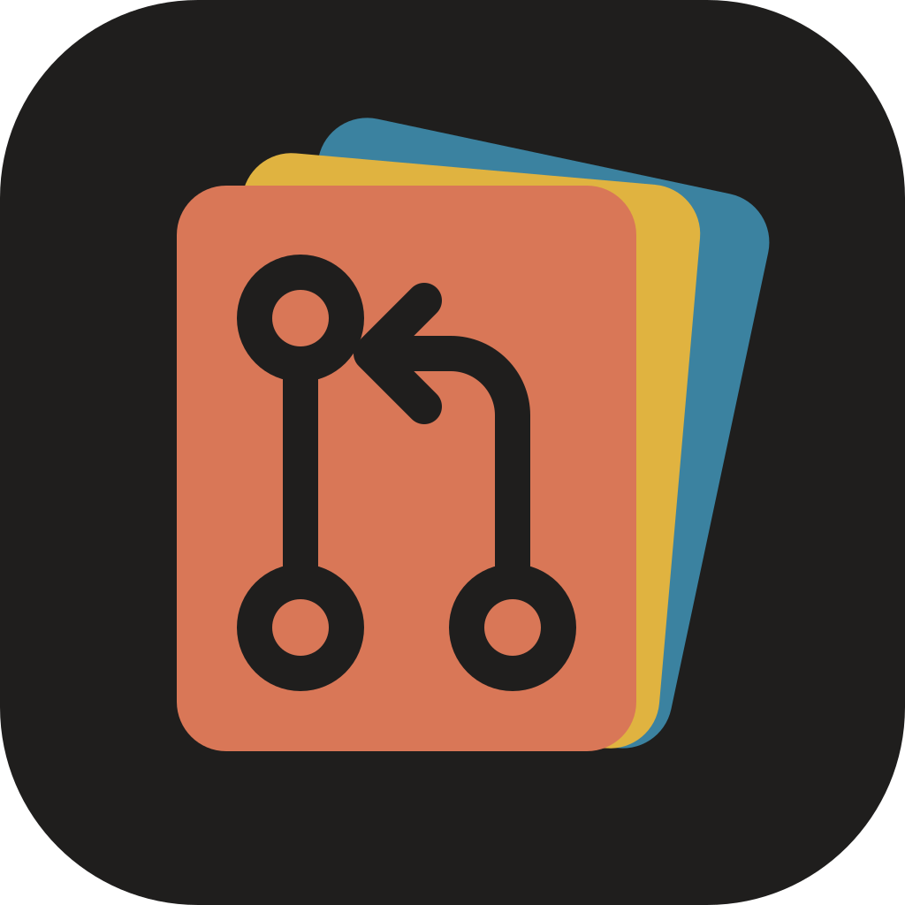
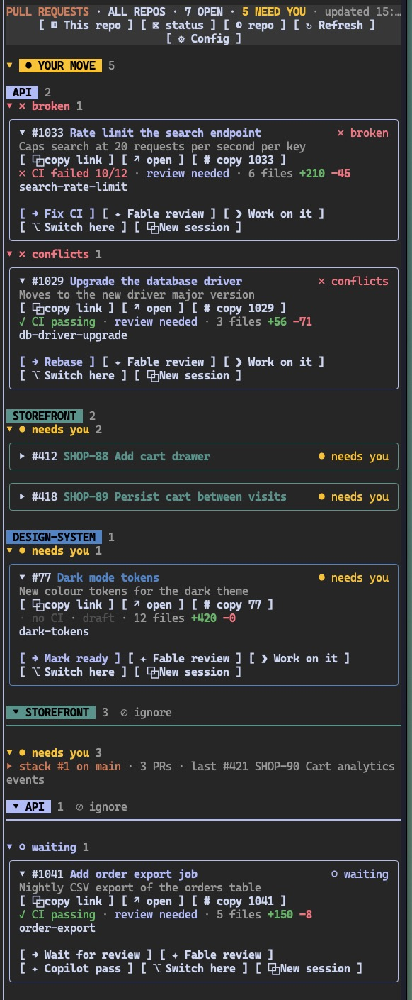

<p align="center"></p>

# pr-deck

> Your open pull requests in a Claude Code side pane



Reads from GitHub, GitLab, Gitea/Forgejo and Azure DevOps.

- [Install](#install)
- [Requirements](#requirements)
- [Usage](#usage)
- [Docs](#docs)

## Install

```
/plugin install pr-deck --marketplace khaosdoctor/claude-pr-deck
```

From a shell:

```bash
claude plugin install pr-deck --marketplace khaosdoctor/claude-pr-deck
```

From a local clone (add `claude --plugin-dir <path to clone>` to load it for one session only):

```bash
claude plugin marketplace add <path to clone>
claude plugin install pr-deck@claude-pr-list-mod
```

Desktop app: click + next to the prompt box, then ***Plugins -> Add marketplace*** with `khaosdoctor/claude-pr-deck`, then ***Add plugin***.

Update, then restart Claude Code:

```bash
claude plugin marketplace update claude-pr-list-mod
claude plugin update pr-deck@claude-pr-list-mod
```

## Requirements

The CLI of each code host you enable, signed in:

| Host | CLI | Sign in |
| --- | --- | --- |
| GitHub | [`gh`](https://cli.github.com) | `gh auth login` |
| GitLab | [`glab`](https://gitlab.com/gitlab-org/cli) | `glab auth login` |
| Gitea, Forgejo | [`tea`](https://gitea.com/gitea/tea) and `jq` | `tea login add` |
| Azure DevOps | [`az`](https://learn.microsoft.com/cli/azure) | `az login`, then `az extension add --name azure-devops` |

## Usage

```
/prs
/prs watch acme/api#7
```

- `/prs` opens the pane.
- `/prs watch <pr>` watches a PR until CI passes, see [Watching a PR](docs/pane.md#watching-a-pr).

## Docs

- [The pane](docs/pane.md): cards, status override, your move, collapse
- [Configuration](docs/configuration.md): options, templates, config file
- [Prompts and PR states](docs/prompts.md): prompt options, placeholders, state diagram, prompts file
- [Sessions](docs/sessions.md): clone folder, terminal detection, new session command
- [External integrations](docs/integrations.md): the state file for status bars and scripts
