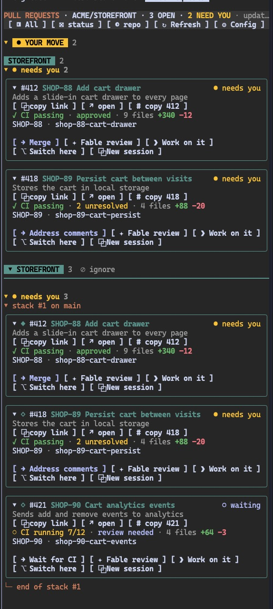
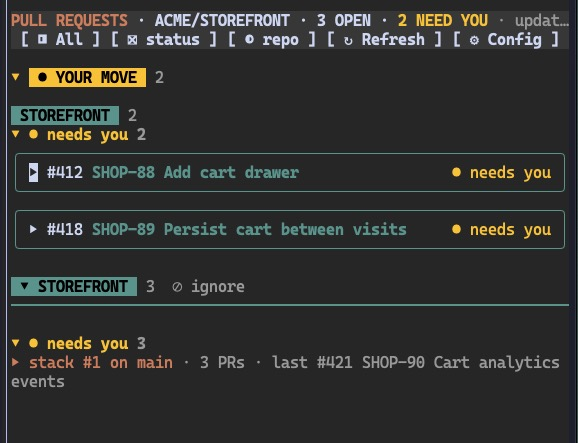

# The pane

[Back to README](../README.md)

- [Cards](#cards)
- [Status override](#status-override)
- [Your move](#your-move)
- [Collapse](#collapse)
- [Watching a PR](#watching-a-pr)

## Cards



- Buttons send the prompts from [Prompts](prompts.md).
- ***⎇ Switch here*** and ***⧉ New session***: see [Sessions](sessions.md).
- On GitHub, ***❯ Work on it*** becomes ***✦ Copilot pass*** once a PR is green, only waiting on people, and Copilot has not been asked yet.

## Status override

***⇄ move*** cycles: ***○ waiting***, ***● needs you***, ***✓ approved***, ***auto***.

- Use it when the automatic status is wrong.
- Colour, group, ***● YOUR MOVE*** and the ***NEED YOU*** count follow the override.
- Saved in the [config file](configuration.md#config-file).

## Your move

A PR needs you when its next action is yours now: mark ready, fix CI, rebase, address comments, request a review or merge.

With **Pin "Your move" on top**, these PRs are also listed in ***● YOUR MOVE*** before the repos.

- A stack where every PR needs you moves there whole.
- Any other stack stays in its repo, and the PRs that need you show in both places.

The states behind this are in [Prompts per state](prompts.md#prompts-per-state).

## Collapse

***⊖ collapse*** goes one level per press, then opens everything again:

1. Cards to their title line.
2. Status groups and stacks.
3. Repos and ***● YOUR MOVE***.



## Watching a PR

```
/prs watch acme/api#7
```

***◉ watch*** and `/prs watch` ask the session to watch a PR until CI passes. `/prs watch` needs no open pane.

- The PR is a number, `owner/repo#number` or its URL.
- A bare number open in more than one repo picks the session's repo, and otherwise asks for `owner/repo#number`.
- A PR the session has not seen yet makes it refresh first.
- The prompt is the **Watch prompt** option, see [Prompt options](prompts.md#prompt-options).
