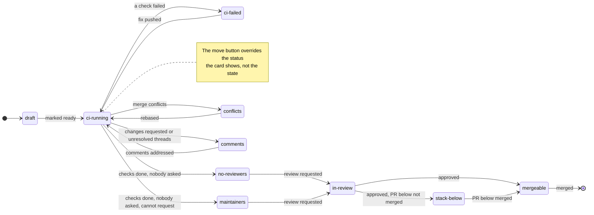

# Prompts

[Back to README](../README.md)

- [Prompt options](#prompt-options)
- [Placeholders](#placeholders)
- [Session name](#session-name)
- [Prompts per state](#prompts-per-state)
- [Prompts file](#prompts-file)

## Prompt options

Templates set in `/config` under pr-deck, or in `~/.claude/settings.json`. Empty means the default.

**Fable review prompt**, sent by ***✦ Fable review***:

```
Spawn a subagent with model fable to review {url} against the repo's own standards. Report findings to me, do not post anything to {host}.
```

**Work on it prompt**, sent by ***❯ Work on it*** and the first prompt of ***⧉ New session***:

```
Load context for {url}: check out branch {branch} in the {repo} repo, read the PR description, diff, CI status and review comments ({cli} reads them), then wait for my instructions.
```

**Watch prompt**, sent by ***◉ watch*** and `/prs watch`:

```
Watch {url} until it is green: re-check its CI and review state with {cli} every few minutes, waiting in the background between checks, tell me about each change in one line, and stop as soon as CI passes and nothing else needs me.
```

**Session name** defaults to `pr-{pr}-worker`.

```json
{
  "pluginConfigs": {
    "pr-deck@claude-pr-list-mod": {
      "options": {
        "sessionName": "{repo}-{pr}",
        "workPrompt": "Check out {branch} of {fullName}, read PR #{pr} ({title}) and its review threads with {cli}, then wait."
      }
    }
  }
}
```

- For PR #3109 on `acme/node`, branch `fix-logging`, that names the session `node-3109`.
- Saving reloads the mod.
- The ***✦ Copilot pass*** prompt cannot be changed.

## Placeholders

| Placeholder | Value |
| --- | --- |
| `{pr}`, `{number}` | PR number |
| `{url}` | PR link |
| `{title}` | PR title |
| `{branch}` | head branch |
| `{base}` | base branch |
| `{repo}` | repo name |
| `{fullName}` | `owner/repo` |
| `{host}` | code host name, such as `github.com` |
| `{cli}` | the host's command line tool, such as `gh` |

Filled in as plain text, with no shell quoting. An unknown one stays as written.

## Session name

***⧉ New session*** starts `claude -n <name>` and ***⎇ Switch here*** runs `/rename <name>`.

- Anything that is not an ASCII letter, digit, `.`, `_` or `-` becomes `-`, and leading dashes are dropped.
- An empty name, or ***Auto rename sessions*** off, skips naming.

## Prompts per state



The next-action button, ***❯ Work on it*** and ***◉ watch*** can send a different prompt per state.

- A PR is in the first state that matches, in this order: `draft`, `ci-failed`, `conflicts`, `comments`, `mergeable`, `stack-below`, `ci-running`, `no-reviewers`, `maintainers`, `in-review`.
- The wait-only states are `stack-below`, `ci-running`, `maintainers` and `in-review`. They have no prompt of their own, so a `next` template turns the wait into a button and the PR starts counting as needing you.

## Prompts file

```jsonc
{
  "ci-failed": {
    "next": "CI is failing on {url}. Read the failing logs with {cli}, fix the cause and push.",
    "work": "Check out {branch} and reproduce the failing checks of #{pr} locally, then wait."
  },
  "in-review": {
    "next": "Draft a short nudge for the reviewers of {url}."
  }
}
```

`~/.config/pr-deck.prompts.jsonc` is yours, the mod only reads it, so comments and trailing commas are fine. Each state takes up to three templates, and anything left out keeps the default:

- `next` replaces the next-action prompt.
- `work` replaces the ***❯ Work on it*** and ***⧉ New session*** prompt in that state.
- `watch` replaces the ***◉ watch*** prompt in that state.

They take the [placeholders](#placeholders) plus `{readyHint}` (the host's command for marking a PR ready, like `gh pr ready`) and `{state}`.

- A file that does not parse shows the error in the pane, and the defaults stay.
- Edits apply on the next refresh.
- ***✎ open prompts file*** on the ***⚙ Config*** screen opens the file, and creates it first with every state as a commented-out block holding its default text.
